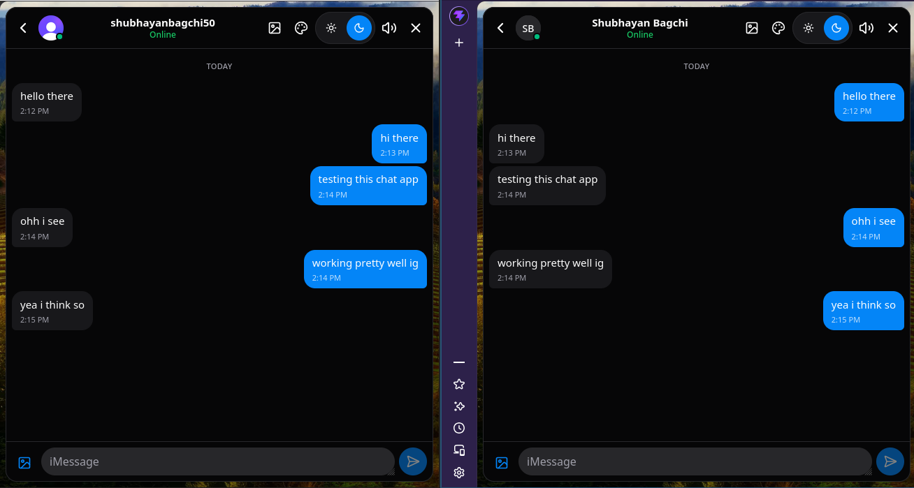
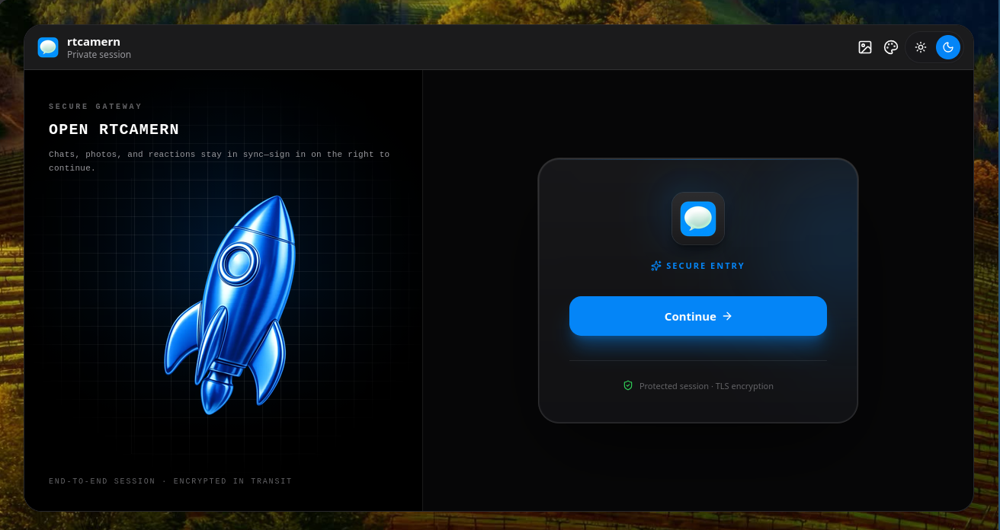
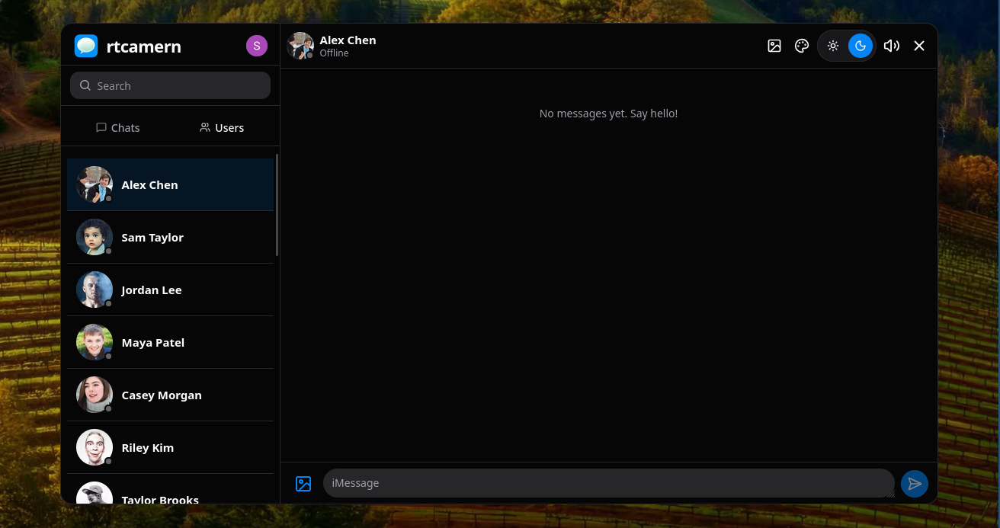
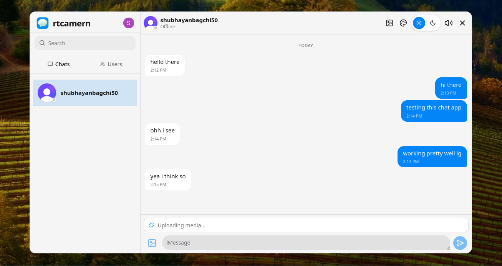
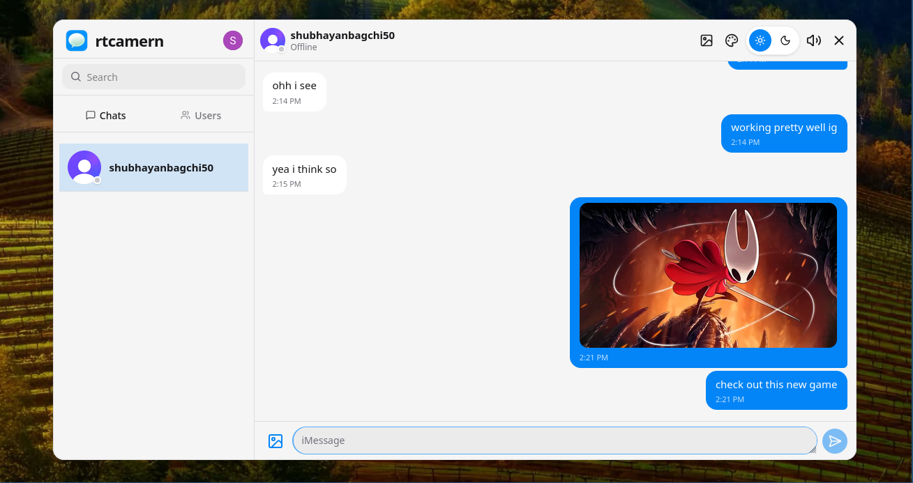

# rtcamern

> **Real-Time Chat Application using MERN Stack + Socket.IO**

A learning-focused, hand-coded real-time chat application built with the MERN stack (MongoDB, Express.js, React, Node.js) and Socket.IO. This project is built from scratch to understand core concepts like authentication, real-time communication, media handling, webhooks, cron jobs, and middleware.

**Live Demo:** [https://rtcamern.onrender.com/](https://rtcamern.onrender.com/)


---

## Table of Contents

- [About](#about)
- [App Demo & Screenshots](#app-demo--screenshots)
- [Project Status](#project-status)
- [Tech Stack](#tech-stack)
- [Architecture Overview](#architecture-overview)
- [Folder Structure](#folder-structure)
- [Prerequisites](#prerequisites)
- [Getting Started (Local Setup)](#getting-started-local-setup)
- [Docker (Single Container)](#docker-single-container)
- [Environment Variables](#environment-variables)
- [Core Concepts](#core-concepts)
- [Documentation](#documentation)
- [API Reference](#api-reference)
- [Socket.IO Events](#socketio-events)
- [Database Models](#database-models)
- [Theming, Wallpapers & Sounds](#theming-wallpapers--sounds)
- [Deployment](#deployment)
- [Scripts](#scripts)
- [Project Roadmap/Phases](#project-roadmapphases)
- [Learning Takeaways](#learning-takeaways)
- [Troubleshooting](#troubleshooting)
- [License](#license)

---

## About

**rtcamern** is a resume-ready, production-style real-time chat app built entirely by hand for learning purposes. It covers everything from authentication and real-time messaging to file uploads from scratch, media hosting with ImageKit, webhooks, cron jobs, a custom Socket.IO server, and deployment.

The goal is to deeply understand each concept by implementing it step by step, with thorough documentation explaining the *why* behind every decision.

> **Note on scope:** both the **backend** (auth, messages, uploads, webhooks, cron, Socket.IO) and the **frontend** (chat UI, Hero UI + Tailwind theming, wallpapers, sounds, Zustand stores, Socket.IO client) are implemented. Feature lists below distinguish what is implemented from what is planned.

---

## App Demo & Screenshots

Preview of the application in action:

### 💬 Active Conversation & Real-Time Messaging


### 🔐 Themed Authentication & Customization


### 📱 Responsive Chat Workspace


### 🖼️ Media Sharing & File Uploads



---

## Project Status

### Implemented

- 💬 **1:1 Messaging API** – send text and/or one image/video, fetch history, derive conversation list
- 🔐 **Authentication with Clerk** – `clerkMiddleware()` + a custom `authMiddleware` with dual user sync
- 👥 **Dual User Sync** – lazy sync on first access via `clerkClient.users.getUser()` + proactive Clerk webhooks (`user.created` / `user.updated` / `user.deleted`) with account re-linking (`{ $or: [{ clerkId }, { email }] }`)
- 🎨 **Responsive Chat UI** – sidebar, chat header, message list, media bubbles, and composer built with Hero UI & Tailwind CSS
- 🎭 **Theming, Wallpapers & Sounds** – dark/light toggle, 6 Hero UI theme presets, frame wallpapers, and keyboard sound effects
- ⚡ **Client State Management** – Zustand stores for auth and chat with local persistence and Socket.IO listener binding
- 🟢 **Online Presence (in-memory)** – `userSocketMap` tracks connected users; `getOnlineUsers` broadcasts the list
- 🔔 **Realtime Message Delivery** – `sendMessage` emits `newMessage` to the receiver's socket
- 🖼️ **Image & Video Sharing** – one media attachment per message
- 📤 **File Uploads from Scratch** – Multer memory storage, MIME allowlist, 25 MB limit
- ☁️ **ImageKit Integration** – buffer uploaded to ImageKit, URL stored on the message
- 🧱 **Custom Middleware** – auth, upload, and centralized error handling with explanations
- ⏰ **Cron Job** – keep-alive health ping every 14 minutes (production only)
- 🌱 **Database Seeding** – `yarn seed:users` seeds mock profiles for local chat testing
- 🌐 **REST API** – users, conversations, messages, auth, Clerk webhook
- 💾 **MongoDB Integration** – Mongoose `User` and `Message` schemas
- 🚀 **Single-Container Deployment** – Dockerfile builds frontend + backend; Render hosts the monolith
- 📚 **Thorough Documentation** – architecture, setup, API, sockets, media, middleware, deployment

### Planned / Partial

- 🚧 **Socket.IO** – no handshake authentication yet; rooms, typing indicators, and read receipts are designed but not built (see [BUGS.md](./BUGS.md))
- ⏳ **Conversation model** – conversations are currently derived from messages; no `Conversation` collection
- ⏳ **Group chats** – 1:1 only for now
- ⏳ **Pagination** – message history returns everything
- ⏳ **Read receipts, delivery status, `lastSeen`**

---

## Tech Stack

| Layer | Technology | Notes |
|---|---|---|
| **Frontend** | [React](https://react.dev/) 19 + [Vite](https://vite.dev/) 8 + TypeScript | React Compiler, React Router, Zustand, Axios, Socket.IO client |
| **Styling** | [Tailwind CSS](https://tailwindcss.com/) 4 + [Hero UI](https://heroui.com/) 3 | Theme presets, dark/light mode, wallpapers, accessible components |
| **Backend** | [Node.js](https://nodejs.org/) 22 + [Express](https://expressjs.com/) 5 + TypeScript | TypeScript `^7.0.2` |
| **Real-Time** | [Socket.IO](https://socket.io/) 4 | Custom server, attached to the same HTTP server as the API |
| **Database** | [MongoDB](https://www.mongodb.com/) + [Mongoose](https://mongoosejs.com/) 9 | External database (Atlas in production) |
| **Auth** | [Clerk](https://clerk.com/) (`@clerk/express`, `@clerk/react`) | Session verification + webhooks |
| **Media** | [Multer](https://github.com/expressjs/multer) 2 + [ImageKit](https://imagekit.io/) | Uploads from scratch, cloud hosting |
| **Cron Jobs** | [`cron`](https://github.com/kelektiv/node-cron) | **Not** `node-cron` |
| **Webhooks** | `verifyWebhook` from `@clerk/backend/webhooks` | Transitive dep of `@clerk/express`; no direct `svix` dependency |
| **Env Config** | [dotenv](https://github.com/motdotla/dotenv) | Loaded from `backend/.env` |

> `bcryptjs` and `jsonwebtoken` are still in `backend/package.json` but unused — Clerk handles auth.

---

## Architecture Overview

rtcamern is a monolith at runtime: one Express 5 process serves the REST API, the Socket.IO endpoint, and (in production) the built React SPA.

- **Frontend (React + Vite)** — Clerk sign-in/out today; REST and socket clients are planned.
- **Backend (Express + Node)** — auth, message handling, media uploads to ImageKit, Clerk webhooks, cron, and Socket.IO.
- **MongoDB** stores users and messages; **ImageKit** stores media; **Clerk** owns identities.

Request flow: Clerk token/session → `clerkMiddleware()` → router-level `authMiddleware` (loads the Mongo `User`) → controller → Mongoose. Sending a message goes `POST /api/messages/send/:id` → Multer → ImageKit → Mongo → `newMessage` over Socket.IO.

See **[docs/ARCHITECTURE.md](./docs/ARCHITECTURE.md)** for details.

---

## Folder Structure

```text
rtcamern/
├── Dockerfile          # Single-image monolith build (frontend + backend)
├── AGENTS.md           # Agent instructions for this project
├── BUGS.md             # Known bugs / deferred fixes (Socket.IO)
├── backend/            # Express + TypeScript API
│   ├── src/
│   │   ├── constants/   # env.ts (validated at import), http-status.ts
│   │   ├── controllers/ # auth.controller.ts, message.controller.ts
│   │   ├── lib/         # db.ts, imagekit.ts, socket.ts, cron.ts
│   │   ├── middlewares/ # auth, upload, error (note: plural)
│   │   ├── models/      # user.model.ts, message.model.ts
│   │   ├── routes/      # auth.route.ts, message.route.ts
│   │   ├── types/       # express.d.ts (optional req.user)
│   │   ├── webhooks/    # clerk.webhook.ts
│   │   └── index.ts     # Entry point
│   ├── docker-compose.yaml  # Standalone MongoDB for local dev
│   ├── .env.example
│   └── package.json
├── frontend/           # React + Vite + TypeScript client
│   ├── src/
│   │   ├── assets/
│   │   ├── App.tsx      # Clerk SignIn/SignUp/UserButton only
│   │   ├── App.css
│   │   ├── index.css
│   │   └── main.tsx     # ClerkProvider
│   ├── public/
│   └── package.json
└── docs/               # Comprehensive project documentation
```

---

## Prerequisites

- [Node.js](https://nodejs.org/) 22 LTS (the Docker image uses `node:22`)
- [Yarn](https://yarnpkg.com/) v4 (Berry, pinned to `4.18.1` via `packageManager` in both packages)
- [MongoDB](https://www.mongodb.com/) — local (or `backend/docker-compose.yaml`) or Atlas free tier
- [Git](https://git-scm.com/)
- [Clerk](https://clerk.com/) account (free)
- [ImageKit](https://imagekit.io/) account (free) — **required**: the backend throws at startup without ImageKit env vars

---

## Getting Started (Local Setup)

1. **Clone the repo**
   ```bash
   git clone <your-repo-url>
   cd rtcamern
   ```

2. **Backend setup**
   ```bash
   cd backend
   yarn install
   cp .env.example .env
   # Fill in MONGO_URI (or MONGO_URI_DOCKER), Clerk keys, and all three ImageKit vars
   yarn dev
   ```
   Server runs at `http://localhost:3000`. Health check: `GET /health` → `{"ok":true}`.

   The backend validates env at import time and exits if MongoDB or ImageKit config is missing, so `.env` must exist before `yarn dev` (run it from `backend/` — `dotenv` reads the process cwd).

   Optional local MongoDB:
   ```bash
   yarn docker:up    # starts MongoDB from backend/docker-compose.yaml
   yarn docker:down
   ```

3. **Frontend setup** (new terminal)
   ```bash
   cd frontend
   yarn install
   yarn dev
   ```
   App runs at `http://localhost:5173` (set `VITE_CLERK_PUBLISHABLE_KEY` in `frontend/.env`).

For detailed step-by-step instructions, see **[docs/SETUP.md](./docs/SETUP.md)**.

---

## Docker (Single Container)

The app ships as a **single Docker image**: the Express API serves the built Vite frontend (monolith). MongoDB is external ([MongoDB Atlas](https://www.mongodb.com/atlas) free tier) — no database runs inside the container.

Build (frontend `VITE_*` values are inlined at build time, so pass them as `--build-arg`):

```bash
docker build \
  --build-arg VITE_CLERK_PUBLISHABLE_KEY=pk_live_xxx \
  -t rtcamern:latest .
```

Run (point `MONGO_URI` at Atlas):

```bash
docker run --rm -p 3001:3001 \
  -e MONGO_URI="mongodb+srv://<user>:<pass>@cluster0.xxxxx.mongodb.net/?retryWrites=true&w=majority" \
  -e DB_NAME=rtcamern \
  -e CLERK_SECRET_KEY=sk_live_xxx \
  -e IMAGEKIT_PRIVATE_KEY=private_xxx \
  -e IMAGEKIT_URL_ENDPOINT=https://ik.imagekit.io/your_id/ \
  -e IMAGEKIT_ID=your_id \
  -e FRONTEND_URL=http://localhost:3001 \
  rtcamern:latest
```

Then open `http://localhost:3001`.

Notes:
- The image sets `NODE_ENV=production` and `PORT=3001`, so the backend reads `MONGO_URI` (not `MONGO_URI_DOCKER`).
- It runs as the non-root `node` user and has no `EXPOSE` instruction — publish the port with `-p` as shown (the host platform manages health checks).
- Build layout: frontend `dist` → `/app/public`, compiled backend JS → `/app/dist`.
- Because the SPA is served by the API itself, no CORS setup is needed for that deploy; `FRONTEND_URL` should be the service's own URL.
- `.dockerignore` excludes `.env*`, `docs/`, and all `*.md`, so secrets and docs are not baked into the image.

---

## Environment Variables

Environment variables are documented in detail in **[docs/ENV.md](./docs/ENV.md)**.

**Backend (`backend/.env`):**
```env
NODE_ENV=development
PORT=3000

# Database (production uses MONGO_URI; dev/test prefers MONGO_URI_DOCKER)
MONGO_URI=mongodb://localhost:27017
MONGO_URI_DOCKER=mongodb://localhost:27017
DB_NAME=rtcamern

# Clerk
CLERK_PUBLISHABLE_KEY=pk_test_...      # not read by the backend; kept for parity with .env.example
CLERK_SECRET_KEY=sk_test_...
CLERK_WEBHOOK_SIGNING_SECRET=whsec_...   # optional; webhook 503s without it

# CORS origin
FRONTEND_URL=http://localhost:5173

# ImageKit — all three are required at startup
IMAGEKIT_PRIVATE_KEY=private_...
IMAGEKIT_URL_ENDPOINT=https://ik.imagekit.io/your_id/
IMAGEKIT_ID=your_id
```

**Frontend (`frontend/.env`):**
```env
VITE_CLERK_PUBLISHABLE_KEY=pk_test_...
```

`VITE_API_URL` / `VITE_SOCKET_URL` are **not used yet** — there is no API or socket client in the frontend. They are documented in `docs/ENV.md` as planned variables.

---

## Core Concepts

Understanding these concepts is the heart of this learning project. Each is explained thoroughly in code and docs:

| Concept | What You'll Learn | Status | Docs |
|---|---|---|---|
| **Authentication (Clerk)** | Session verification, `clerkMiddleware()`, protected routes, webhook user sync | ✅ Implemented | [docs/AUTH.md](./docs/AUTH.md) |
| **File Uploads from Scratch** | Multer config, memory vs disk, validation, limits, MIME checks | ✅ Implemented | [docs/MEDIA.md](./docs/MEDIA.md) |
| **ImageKit Media** | Uploading buffers, URLs, CDN delivery | ✅ Implemented (transformations planned) | [docs/MEDIA.md](./docs/MEDIA.md) |
| **Middleware Explained** | Auth, upload, error middleware and the exact execution order | ✅ Implemented | [docs/MIDDLEWARE.md](./docs/MIDDLEWARE.md) |
| **Webhooks** | Event-driven sync, Svix signature verification, raw body handling | ✅ Implemented | [docs/WEBHOOKS_CRON.md](./docs/WEBHOOKS_CRON.md) |
| **Cron Jobs** | Scheduling, production-only start, keep-alive pings | ✅ Implemented (single job) | [docs/WEBHOOKS_CRON.md](./docs/WEBHOOKS_CRON.md) |
| **Custom WebSocket Server** | Socket.IO setup on the HTTP server, presence, targeted emits | 🚧 Partial | [docs/SOCKETS.md](./docs/SOCKETS.md) |
| **Realtime Features** | Socket auth, rooms, typing, read receipts | ⏳ Planned | [docs/SOCKETS.md](./docs/SOCKETS.md) |
| **Theming & Personalization** | Dark/Light, themes, wallpapers, sounds | ⏳ Planned | [docs/UI.md](./docs/UI.md) |

---

## Documentation

All project documentation lives in the [`docs/`](./docs/) folder and is kept in sync with the codebase:

| Document | Purpose |
|---|---|
| **[ARCHITECTURE.md](./docs/ARCHITECTURE.md)** | High-level system design, data flow, tech stack (diagrams pending) |
| **[SETUP.md](./docs/SETUP.md)** | Step-by-step local setup guide |
| **[ENV.md](./docs/ENV.md)** | Environment variables reference with explanations |
| **[DATABASE.md](./docs/DATABASE.md)** | User and Message schemas (Conversation is design-only) |
| **[AUTH.md](./docs/AUTH.md)** | Clerk auth flow, token/session verification, webhooks, user sync |
| **[API.md](./docs/API.md)** | REST API endpoints, auth, request/response examples |
| **[SOCKETS.md](./docs/SOCKETS.md)** | Socket.IO target design + current partial implementation |
| **[MEDIA.md](./docs/MEDIA.md)** | File uploads from scratch (Multer) + ImageKit integration |
| **[MIDDLEWARE.md](./docs/MIDDLEWARE.md)** | Auth, upload, error middleware deep-dive |
| **[WEBHOOKS_CRON.md](./docs/WEBHOOKS_CRON.md)** | Webhooks & cron jobs explained with examples |
| **[UI.md](./docs/UI.md)** | Theming, wallpapers, sounds, design system (plan) |
| **[DEPLOYMENT.md](./docs/DEPLOYMENT.md)** | Deployment guide (single-container and split hosting) |
| **[TROUBLESHOOTING.md](./docs/TROUBLESHOOTING.md)** | Common issues and fixes |
| **[BUGS.md](./BUGS.md)** | Known bugs and deferred Socket.IO fixes |

`AGENTS.md` at the repo root holds high-signal guidance for AI agents working in this repo.

---

## API Reference

Full details in **[docs/API.md](./docs/API.md)**. Implemented routes:

| Method | Route | Auth | Purpose |
|---|---|---|---|
| `GET` | `/health` | Public | Health check → `{ ok: true }` |
| `GET` | `/api/auth/me` | Protected | Current user from MongoDB (`404` if not synced yet) |
| `GET` | `/api/messages/users` | Protected | Users for the sidebar |
| `GET` | `/api/messages/conversations` | Protected | Chat partners, derived from messages |
| `GET` | `/api/messages/:id` | Protected | 1:1 message history with one user |
| `POST` | `/api/messages/send/:id` | Protected | Send text and/or media (multipart field `media`, ≤ 25 MB) |
| `POST` | `/api/webhooks/clerk` | Public (Svix-verified) | Clerk user lifecycle events |

Not implemented yet: `/api/conversations` CRUD, `/api/upload` (media goes through the send route), pagination.

---

## Socket.IO Events

Current implementation (see **[docs/SOCKETS.md](./docs/SOCKETS.md)** for the full target design):

| Event | Direction | Purpose |
|---|---|---|
| `connection` / `disconnect` | Built-in | Lifecycle; updates the in-memory online map |
| `getOnlineUsers` | Server→Client | Broadcasts the list of online user IDs on connect/disconnect |
| `newMessage` | Server→Client | Emitted by `POST /api/messages/send/:id` to the receiver's socket |

Connection today uses `io(url, { query: { userId } })` — **not authenticated**. Planned events (`conversation:join/leave`, `message:send`, `typing:*`, `message:read*`, `user:online/offline`) are described in the docs but not implemented. Tracked in **[BUGS.md](./BUGS.md)**.

---

## Database Models

Defined in `backend/src/models/` and documented in **[docs/DATABASE.md](./docs/DATABASE.md)**:

- **User** — `clerkId` (unique), `email` (unique), `fullName`, `profilePic`, plus timestamps
- **Message** — `senderId` (ref User), `receiverId` (ref User), `text?`, `image?`, `video?`, plus timestamps

> The `Conversation` model (`participants`, `lastMessage`, `unreadCounts`, `isGroup`, …) is a **design target only** — there is no model file or collection. Conversations are currently derived from `Message` records.

---

## Theming, Wallpapers & Sounds

Implemented using **Tailwind CSS 4** and **Hero UI 3** (detailed guide in **[docs/UI.md](./docs/UI.md)**):

- **Dark/Light Mode** – Instant toggle with local storage persistence
- **Multiple Themes** – 6 Hero UI theme presets (Default, Emerald, Violet, Amber, Rose, Cyan)
- **Wallpapers** – 6 selectable ambient chat frame wallpapers
- **Keyboard Sounds** – Optional sound effects on user actions and keystrokes with toggle switch
- **UI Polish Guidelines** – Responsive layout, message bubbles, avatars with online badges, and composer controls

---

## Deployment

Deployment is documented in **[docs/DEPLOYMENT.md](./docs/DEPLOYMENT.md)**.

The shipped setup is a **single Docker image** on [Render](https://render.com/) (the live demo above), with:

- **Database:** [MongoDB Atlas](https://www.mongodb.com/atlas) (M0 free cluster)
- **Auth:** [Clerk](https://clerk.com/) (free tier)
- **Media:** [ImageKit](https://imagekit.io/) (free tier)

Set `NODE_ENV=production`, `MONGO_URI`, `CLERK_SECRET_KEY`, the ImageKit vars, and `FRONTEND_URL` (the service's public URL). The keep-alive cron pings `FRONTEND_URL/health` every 14 minutes so the free-tier instance stays awake.

Split hosting (Netlify/Vercel frontend + Render backend) is documented as an alternative, but the frontend has no API/socket client yet, so the monolith is the only wired path.

---

## Scripts

### Backend (`backend/package.json`)
```bash
yarn dev        # Start dev server with tsx watch
yarn build      # Compile TypeScript with tsc (outputs to dist/)
yarn start      # Run the compiled app (node dist/index.js)
yarn seed:users # Seed mock users for the chat sidebar (src/seeds/user.seed.ts)
yarn lint       # ⚠️ currently broken: typescript-eslint does not support TS 7.0
yarn format     # Prettier
yarn docker:up  # Start local MongoDB via docker compose
yarn docker:down # Stop it
```

Use `yarn build` as the backend type-check until the lint/TypeScript version mismatch is fixed.

### Frontend (`frontend/package.json`)
```bash
yarn dev      # Start Vite dev server
yarn build    # Build for production (tsc -b && vite build)
yarn lint     # Lint code
yarn format   # Prettier
yarn preview  # Preview production build
```

---

## Project Roadmap/Phases

| Phase | Focus | Status |
|---|---|---|
| **Phase 0: Foundation** | Repo setup, backend/frontend init, health route, docs structure | ✅ Done |
| **Phase 1: Auth & User Sync** | Clerk integration, auth middleware, dual user sync (lazy + webhook) | ✅ Done |
| **Phase 2: Database Models** | User and Message models with Mongoose | ✅ Done (Conversation pending) |
| **Phase 3: REST API Core** | Message send/history, users and conversations for the sidebar | ✅ Done (no `/api/conversations` CRUD, no pagination) |
| **Phase 4: Custom WebSocket Server** | Socket.IO on the HTTP server, presence, `newMessage` | 🚧 Partial (auth, rooms, typing, receipts pending) |
| **Phase 5: File Uploads from Scratch** | Multer config, validation, upload middleware | ✅ Done |
| **Phase 6: ImageKit Integration** | Media upload and URLs | ✅ Done (transformations pending) |
| **Phase 7: Webhooks** | Clerk webhooks, signature verification, user lifecycle | ✅ Done |
| **Phase 8: Cron Jobs** | Scheduled tasks | ✅ Done (keep-alive ping only) |
| **Phase 9: UI/UX & Theming** | Chat UI, dark/light, themes, wallpapers, sounds | ✅ Done |
| **Phase 10: Polish & Deploy** | UI polish, bug fixes, deployment, final docs | 🚧 Partial (Docker image + Render deployment done; UI polish pending) |

*Status is updated as features are implemented. Deferred Socket.IO fixes are tracked in [BUGS.md](./BUGS.md).*

---

## Learning Takeaways

By building this project by hand, you'll gain practical understanding of:

- **MERN Stack** – How frontend, backend, and DB connect end-to-end
- **Real-Time Communication** – WebSockets, Socket.IO events, presence, and the security pitfalls of socket handshakes
- **Authentication** – Clerk sessions, `getAuth`, middleware gating, webhook-driven user sync
- **File Handling** – Multipart uploads, Multer, validation, memory vs disk
- **Cloud Media** – ImageKit uploads and CDN delivery
- **Middleware Patterns** – Auth, error handling, upload processing, and ordering
- **Background Jobs** – Cron scheduling and production-only execution
- **Event-Driven Architecture** – Webhooks vs polling
- **TypeScript End-to-End** – Type safety across client/server with Express 5 quirks
- **Modern UI/UX** – Theming, responsiveness, accessibility (planned)
- **Documentation-First** – Writing docs that explain architecture & concepts
- **Deployment** – Free hosting, env config, CORS, single-container builds

---

## Troubleshooting

For common issues (ports, CORS, Socket.IO, Clerk, uploads, deployment), see **[docs/TROUBLESHOOTING.md](./docs/TROUBLESHOOTING.md)** and **[BUGS.md](./BUGS.md)**.

---

## License

MIT (as noted in the badge). A `LICENSE` file has not been added to the repo yet.
